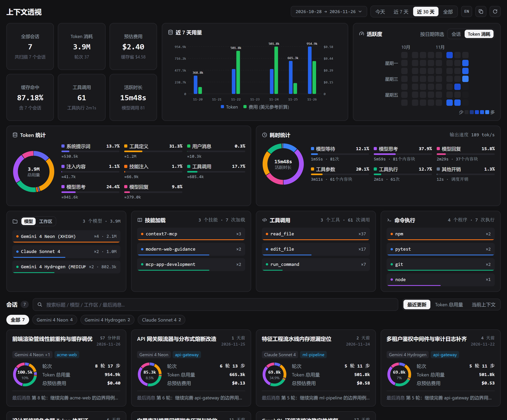
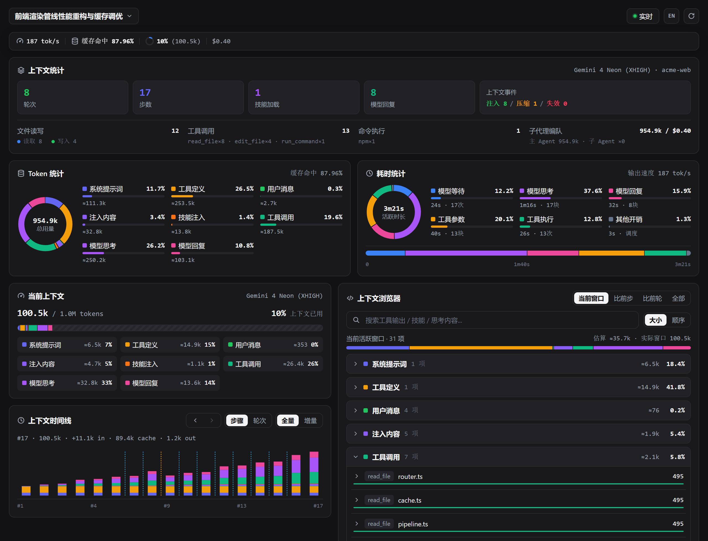

# 上下文透视（Context Lens / `agy-context`）

[English](README.md) | [简体中文](README.zh-CN.md)

**上下文透视（Context Lens）** 是一款完全本地运行、零云端上报的 Antigravity MCP App 插件，提供跨会话全局用量看板与对话内双栏实时上下文剖析。

本项目同时提供 **英文官方版（`main` 分支：`Context Lens`）** 与 **简体中文版（`zh-CN` 分支：`上下文透视`）**，且两个版本均内置右上角 **`EN / 中`** 实时一键切换。

---

## 界面预览

### 全局「上下文透视」看板


### 对话内双栏「上下文」解剖面板


---

## 核心功能

### 1. 全局「上下文透视」看板（左侧导航入口）
- **2×3 核心指标卡**：活跃会话数、Token 总消耗与轮次、美元 API 参考费用与缓存节省、前缀缓存命中率、工具调用次数与并行去重执行耗时、物理校准活跃时长。
- **近 7 天 / 自定义区间双轴柱状图**：Token（蓝）与参考费用（绿）并排双轴展示，支持顶部自定义起止日期选择器（`今天`、`近 7 天`、`近 30 天`、`全部`、`近 14 天`、`本周`、`本月`及任意日期段）。
- **8 周活跃度热力日历**：支持按 `会话数 / Token 消耗` 切换维度，点击任意日期即可钻取单日切片。
- **8 维 Token 环与 6 维耗时环**：
  - Token 分类：`系统提示词`、`工具定义`（按本机已启用插件的技能目录与 MCP Schema 真实标定）、`用户消息`、`注入内容`、`技能注入`、`工具调用`、`模型思考`、`模型回复`。
  - 耗时分类：`模型等待`、`模型思考`、`模型回复`、`工具参数`、`工具执行`（并行区间合并去重）、`其他开销`，并展示校准后的输出速度（`tok/s`）。
- **四列全维度交叉筛选排行**：`[模型 | 工作区]`、`技能加载`、`工具调用`、`命令执行`，点击任意条目即可交叉筛选下方会话卡片。
- **会话卡片矩阵**：按本会话消耗占比标注主力模型（多模型切过时显示 `+N`）与推断工作区、运行中绿点、迷你构成环与最后消息摘要，点击卡片可全屏下钻深度剖析。

### 2. 对话内「上下文」面板（对话右侧栏 `aux_pane`）
- **顶部吸顶实时微 HUD**：常驻展示输出速度（`tok/s`）、缓存命中率、迷你环形已用占比、参考费用与 4 秒 `mtime` 增量实时同步开关（空闲检查约 2ms，不打断中文输入法与滚动阅读）。
- **响应式双栏布局**：380px 窄侧栏流畅单列展示；向右/左拉宽（`>= 840px`）或全屏下钻时自动展开为双栏深度视图。
- **上下文统计与子代理编队**：轮次/步数/技能/回复统计、上下文事件（`注入 / 压缩 / 缓存失效`）、文件读写统计与父子 Agent 消耗汇总。
- **当前上下文窗口条与时间线**：多色水平窗口占比条 + `[步骤 | 轮次]` × `[全量 | 增量]` 时间线，清晰标出上下文压缩、切换模型与缓存骤降节点，支持键盘 `← / →` 回放快照。
- **分组上下文浏览器（`当前窗口 | 比前步 | 比前轮 | 全部`）**：默认仅聚焦最近一次压缩后仍留在活跃窗口内的真实条目，一键切换 `比前步 / 比前轮` 快速定位新增大体积内容，支持读取全量未截断日志与一键复制。

### 3. 对话内嵌快照（`show_context_snapshot`）
- 在对话流中渲染紧凑的单行实时状态微条。

---

## 安装方式

### 方式一：通过中文版分支或 Release 安装（推荐中文用户）
从 [GitHub Releases](https://github.com/kaXianc2-gom/agy-context/releases) 下载 `agy-context-v5.1.0-zh-CN.zip` 解压至 `~/.gemini/config/plugins/agy-context/`，或直接克隆 `zh-CN` 分支：
```bash
git clone -b zh-CN https://github.com/kaXianc2-gom/agy-context.git ~/.gemini/config/plugins/agy-context
```

### 方式二：安装英文官方版（`Context Lens`）
```bash
agy plugin install https://github.com/kaXianc2-gom/agy-context
```

---

## 本地构建与校验

```bash
npm install
npm run build:zh   # 构建中文版产物 (bin/server.cjs + assets/app.html)
npm run build:en   # 构建英文版产物 (bin/server.cjs + assets/app.html)
agy plugin validate .
```

## 隐私与安全

- **纯本地解析**：仅读取本机 `~/.gemini/antigravity/brain/` 对话日志、本地插件目录与本机 `ConversationService`（`localhost`）。
- **零外部联网**：不采集、不上传任何数据，前端遵循严格 MCP App CSP 隔离（`default-src 'none'`）。

## 开源协议

[MIT](LICENSE)
